# 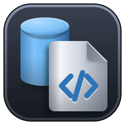 rudbgen

[](https://github.com/xcomart/rudbgen/actions/workflows/ci.yml)
[](LICENSE)


A multi-platform source-code generator written in Rust, built on
[gpui](https://gpui.rs) — the GPU-accelerated UI framework behind the Zed editor
— that reads the metadata of any database with a JDBC driver through an embedded
JVM bridge and renders it through templates. Tick tables, tick templates, get one
file per pair.

> **Status: pre-release.** rudbgen is a rewrite of
> [jdbgen](https://github.com/xcomart/jdbgen), and its template language is
> jdbgen's, engine and all — the same placeholders, conditions, loops and
> decorators, checked against jdbgen's own test suite and byte-identical output
> fixtures. Templates written for jdbgen render here unchanged, but for
> `javaType`, which now gives a `DECIMAL`, `NUMERIC` or `FLOAT` column a Java
> type that holds its values. What has changed is everything around them. See
> [docs/status.md](docs/status.md) for how far the work has come.

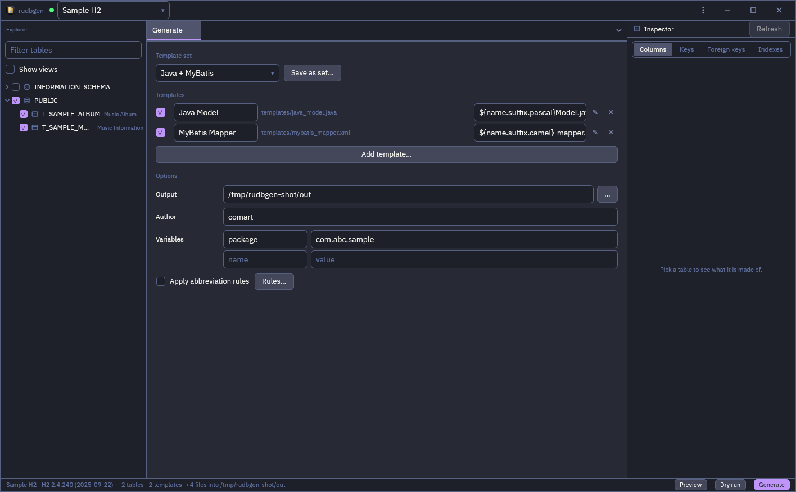

<p align="center">
  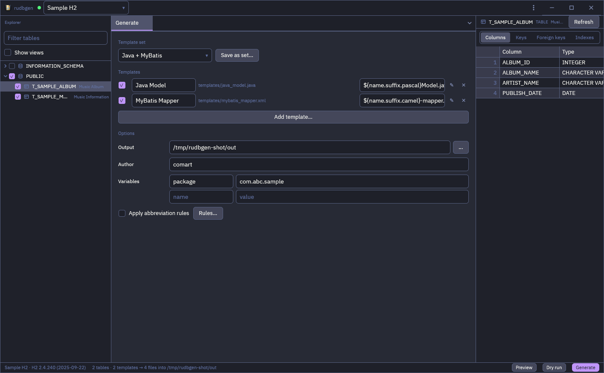
  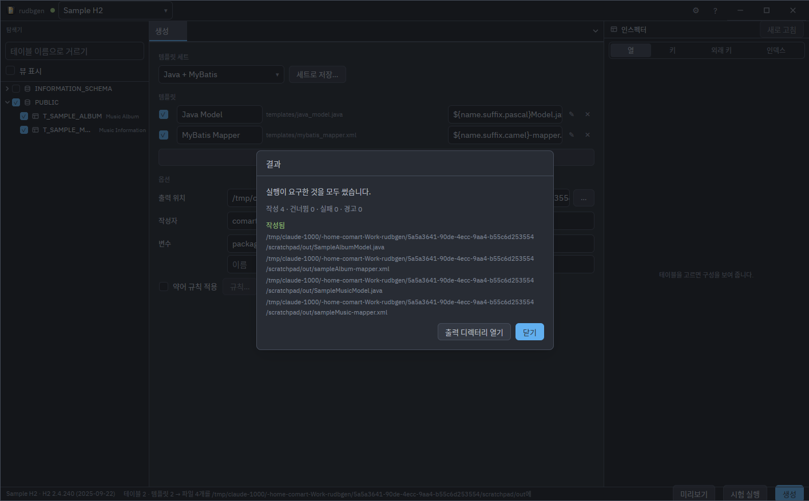
</p>

## What works today

Written against jdbgen, because that is what most of this is for:

- **One window, and nothing to get past.** jdbgen opened a login dialog, then a
  connection manager, then a generator window, each on top of the last. rudbgen
  opens on a welcome screen listing your saved connections; one click connects,
  and the explorer, the work area and the inspector are the same frame from then
  on. Nothing modal stands between you and the first click.
  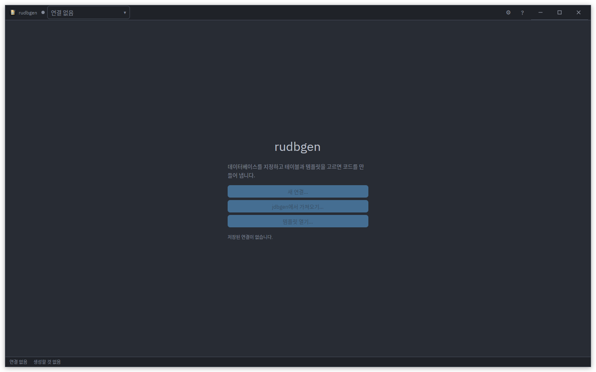
- **Connection folders.** Group saved connections by folder in the connection
  dialog. Click a folder heading to collapse or expand it, or focus it with
  <kbd>Tab</kbd> and press <kbd>Space</kbd> or <kbd>Enter</kbd>. Folded folders
  stay folded when you reopen the dialog during the same app session.
- **No master password.** jdbgen encrypted the URL, the user name and the
  password with a master password you had to type at every start. rudbgen puts
  the password — and an SSH key passphrase — in the operating system's own
  keychain, and stores nothing secret on disk. There is nothing to remember and
  nothing to lose.
- **A schema explorer with a checkbox on every row.** Catalog → schema → table,
  fetched lazily, with jdbgen's contains-filter over it and a views toggle. The
  ticked set survives filtering, collapsing and refreshing — it is only cleared
  by a new connection — and a schema's three-state box acts on the rows you can
  actually see.
- **A table inspector**: columns, the primary key **in key order**, foreign keys
  in *both* directions, and indexes. jdbgen had a Table View modal and neither
  foreign keys nor indexes at all.
- **Foreign keys and indexes in the model the templates see.** `imports`,
  `exports`, `indexes` on a table; `precision`, `scale`, `autoIncrement`,
  `keySeq` and a single-column `fk` on a column. All new, all additions — every
  field jdbgen had answers exactly as it did, but for `javaType`, which follows a
  `DECIMAL`'s precision and scale (`Integer`, `Long` or `BigDecimal` where
  jdbgen said `Integer` for all of them) and calls a `FLOAT` a `Double`.
- **Preview before you write.** The status bar does the arithmetic — *n* tables ·
  *m* templates → *n*×*m* files — **Preview** renders one pair into a tab, and
  **Dry run** renders all of them without writing anything, listing every path,
  whether it replaces something, and how big it would be.
- **A cancellable run with a verdict.** Every template is parsed before any file
  is written, so a syntax error costs nothing and names the template, the half
  and the line. The run has a progress bar, a log and a Cancel that takes effect
  at the next file boundary; an existing file asks Overwrite / Skip / Overwrite
  all / Skip all / Cancel; and it ends in a summary of every file written,
  skipped and failed, with a button to open the output directory. Files are
  written atomically — a crash cannot truncate one.
  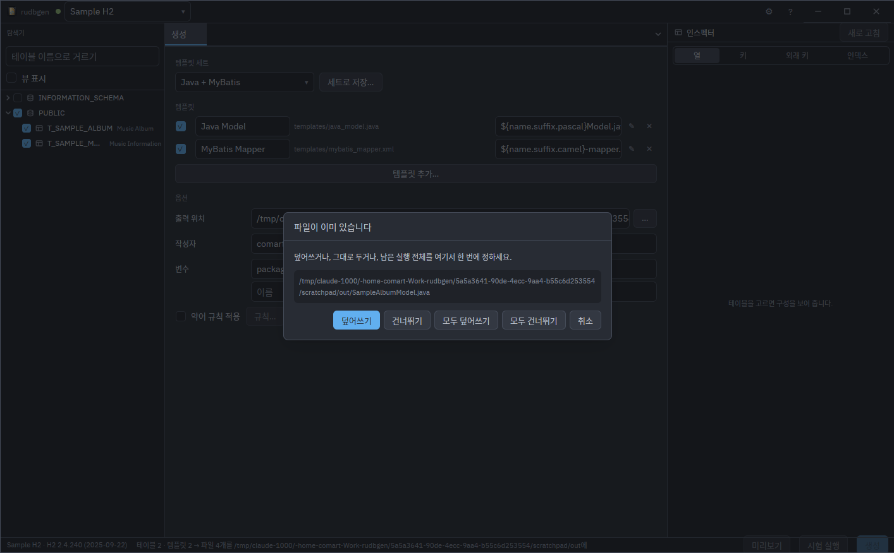
- **Any JDBC driver.** Drivers are downloaded from Maven Central by coordinate
  or picked from disk, the driver class is detected from the JAR without running
  a static initializer, and each set of driver JARs gets its own isolated class
  loader.
- **jdbgen's four custom queries, with a Test button.** For a driver whose
  `DatabaseMetaData` is wrong or missing, supply your own SQL for the table list,
  the column list and the two comment queries. Test runs the statement on a live
  session and tells you *which required label is missing*, instead of letting you
  discover it halfway through a run.
  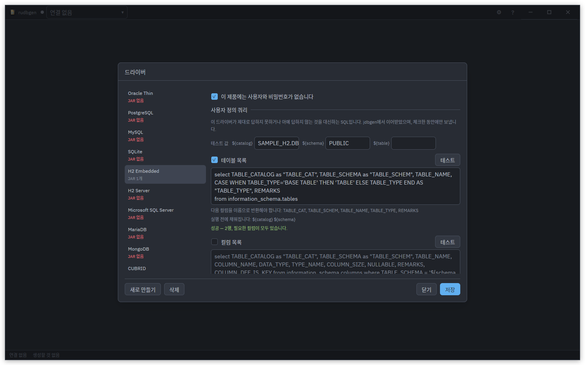
- **SSH tunnels** with SSH-agent, password or private-key auth, loopback binds
  only, and no PTY on the bastion — `nologin` jump hosts work.
- **Templates are documents, not file paths.** A template opens in a tab of its
  own: the editor with template-language highlighting layered over the output
  file's own language, a live preview that follows the *buffer* against a table
  you pick, gutter marks for parse errors and for **unknown fields** — jdbgen's
  way of finding a typo like `${nmae}` was to read the generated file — a
  clickable variable palette of every field the model offers, and completion on
  <kbd>Ctrl</kbd>+<kbd>Space</kbd>. `${ENDIF}`, `${Else}` and the rest of the
  block keywords work in any case, as every other statement name always did —
  jdbgen took only lower case and silently read `${ELSE}` as a field.
  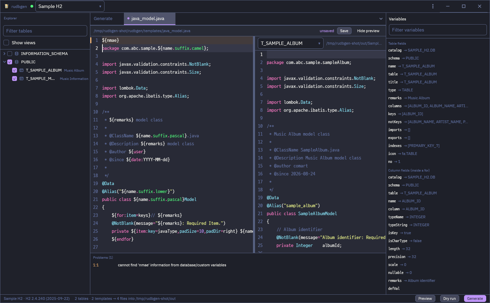
  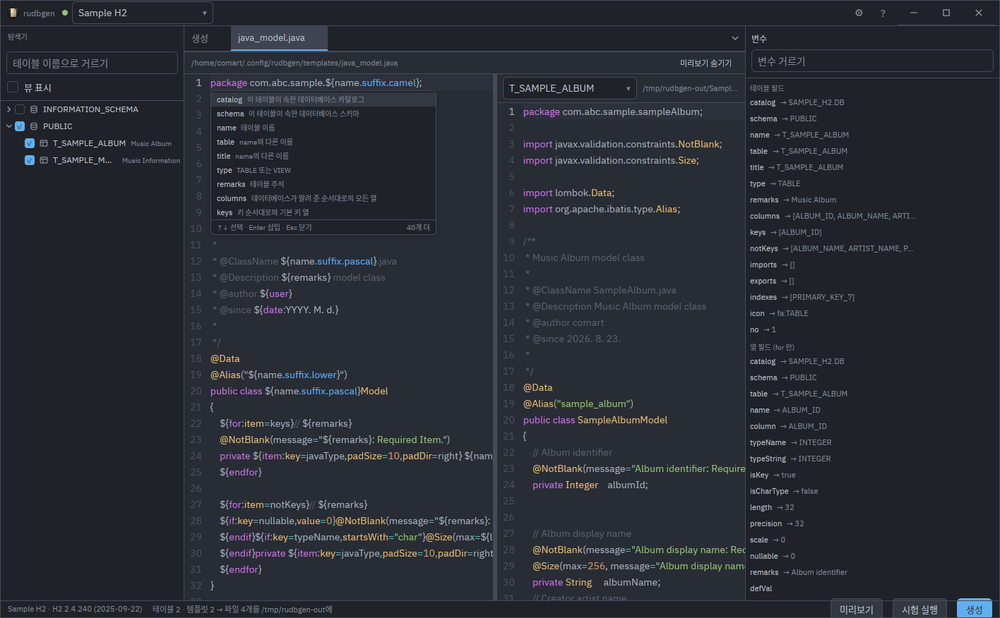
- **An abbreviation rules editor.** The four-column table jdbgen kept in its
  configuration window, with a trailing empty row, a table-name picker for
  whole-name rules, and a refusal to save two rules that would silently become
  one. Word rules now match **whatever the case**, a deliberate behavioral
  break from jdbgen — where they only ever matched lower-case segments and so
  never fired on `TB_USR`.
  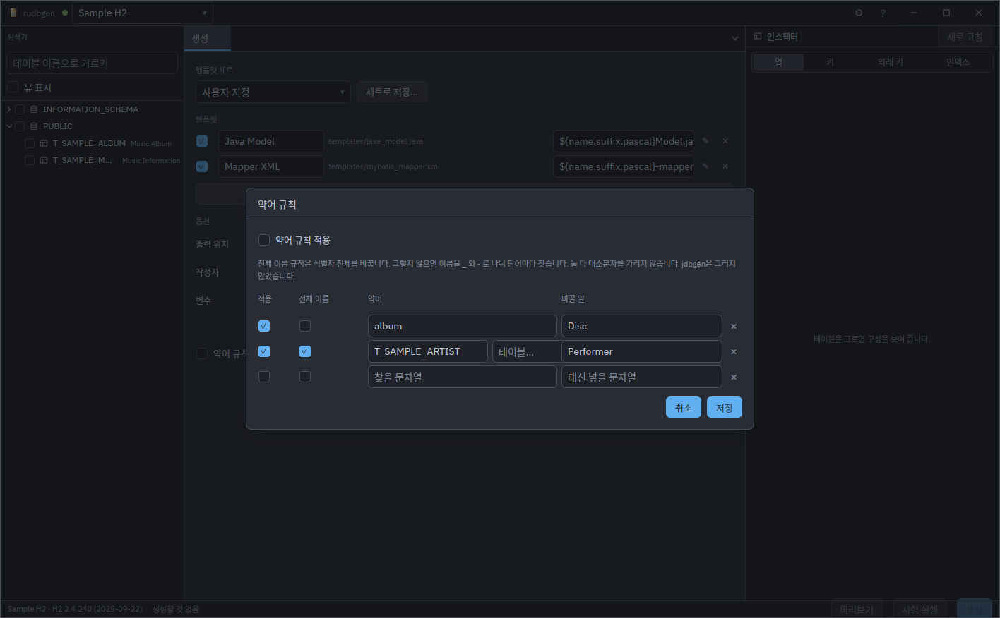
- **A one-time import from jdbgen.** Point it at a `config.json`, type the
  master password once, and it reads both of jdbgen's encryption formats, shows
  what it found with a checkbox each, and writes your connections, drivers,
  template sets and abbreviation rules — passwords into the OS keychain. Your
  jdbgen configuration is opened read-only and left exactly as it was.
  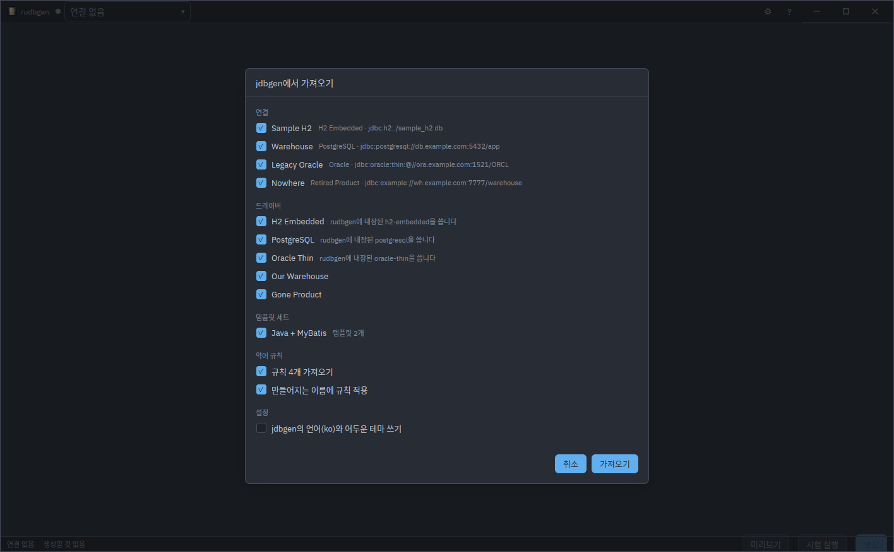
- **Themes and languages**: UI and editor theme registries with live preview,
  import/export and a user theme directory; eight interface languages (en, ko,
  ja, zh-CN, de, es, fr, ru), switched live.

## Installing

Download the build for your platform from
[Releases](https://github.com/xcomart/rudbgen/releases). **No JDK needed** —
every download carries a Java runtime built with `jlink`, and rudbgen uses the
one next to its executable.

- **Windows** — two downloads, the same program inside.
  - `…-setup.exe` is an installer. It installs into your user profile, so it
    needs no administrator rights and raises no UAC prompt, and it adds a
    Start-menu entry plus an **Apps & features** entry you can uninstall from
    later. Uninstalling removes only the program: settings, themes and saved
    connections stay. This is also what `winget` installs.
  - `….zip` is the same tree, portable. Unzip it wherever you like and run
    `rudbgen.exe` from inside the folder — keep the folder together, because
    the executable finds its Java runtime and bridge JAR beside itself.

  Either way the executable is self-signed at best, so SmartScreen may say
  "Windows protected your PC"; choose **More info → Run anyway**.
- **macOS** — unpack the `.tar.gz` and drag `rudbgen.app` to Applications. The
  bundle is ad-hoc signed rather than notarized, so Gatekeeper quarantines
  it on arrival: the first launch needs **right-click → Open** instead of a
  double-click, and if macOS still refuses (newer versions offer no way
  through), drop the quarantine flag and launch normally:

  ```sh
  xattr -r -d com.apple.quarantine /Applications/rudbgen.app
  ```

  On macOS 15 and later there is a second hurdle. The system asks each app
  separately for permission to reach the local network, and because the
  bundle is only ad-hoc signed it usually never gets the prompt and never
  appears under **System Settings → Privacy & Security → Local Network**,
  which offers no way to add an app by hand. The permission is then denied
  silently: connections to a database on your LAN — a `192.168.x.x` or
  `10.x.x.x` address, or a `.local` name — fail with "No route to host",
  while `localhost` connections work as usual. The dependable way through is
  to launch the binary from Terminal, whose execution context is always
  allowed on the local network:

  ```sh
  /Applications/rudbgen.app/Contents/MacOS/rudbgen
  ```

  It has to be the executable itself; `open rudbgen.app` hands the launch to
  launchd and does not count. If you would rather try to get the prompt
  back, run `tccutil reset All com.aihouse.rudbgen`, delete every copy of
  `rudbgen.app` (empty the Trash too), reboot, then reinstall and launch —
  with an ad-hoc signature it may or may not ask. Updating to macOS 15.2 or
  newer, which fixed several of these cases, also helps.
- **Linux** — unpack the `.tar.gz` and run `./install.sh`. It copies the tree
  to `~/.local/share/rudbgen`, links it from `~/.local/bin/rudbgen`, and
  installs the desktop entry and icons. Needs no root, and the launcher in
  the application menu works whether or not `~/.local/bin` is on your `PATH`
  (add it to start rudbgen from a shell too). The binary needs glibc 2.35 or
  newer: Ubuntu 22.04, Debian 12 and later, or a distribution built on them,
  MX Linux 23 among them. The script checks for it and for the system
  libraries rudbgen needs — libxcb, xkbcommon with its X11 half and an EGL or
  Vulkan loader — and prints the command that installs any that are missing.

Each archive also carries a sample H2 database under `sample/`, so there is
something to connect to before there is anything to connect to.

Every platform's caveats, the data directory, the keychain and the updater are
in [docs/installation.md](docs/installation.md).

The bundled runtime always wins when it is there. `RUDBGEN_JAVA_HOME` (Java 17
or newer), then `JAVA_HOME`, are only consulted when there is no `runtime`
directory beside the executable.

## Building

Prerequisites: stable Rust, and a JDK (17+) for the bridge.

```sh
# The Java half first: the Rust build refuses to proceed without the bridge JAR.
cd bridge && ./gradlew build && cd ..

# Then the workspace.
cargo build --release
```

`cargo build` does not invoke Gradle — having a JVM start every time you fix a
line of Rust would be intolerable. `rudbgen-jdbc`'s build script only checks that
`bridge/build/libs/rudbgen-bridge.jar` exists and tells you what to run when it
does not.

A build from source has no bundled runtime, so it looks for a JVM on the system —
`RUDBGEN_JAVA_HOME`, then `JAVA_HOME`, then the usual locations. Only the release
archives ship a runtime of their own.

Running the tests mirrors CI: the bridge suite first, then the Rust workspace,
whose integration tests boot a real JVM against a real in-memory H2 (the driver
JAR comes from the Gradle cache, or from `RUDBGEN_TEST_H2_JAR`):

```sh
cd bridge && ./gradlew build && cd ..
cargo test --workspace
```

On Linux, gpui links against `libxkbcommon` (with its X11 half),
`wayland-client` and `fontconfig` development packages; see
[.github/workflows/ci.yml](.github/workflows/ci.yml) for the exact list.

Release archives are built by
[.github/workflows/release.yml](.github/workflows/release.yml) from a version
tag: Gradle, then `jlink`, then `cargo`, then packaging.

## Documentation

- [Installation](docs/installation.md) · [User interface
  guide](docs/ui-guide.md)
- [Template reference](docs/template-reference.md) — the language, its fields,
  and every place the port deliberately differs from jdbgen
- [Custom queries](docs/custom-queries.md) — for a driver whose metadata is
  wrong

## Architecture

SSH transport, tunnel ownership, connection validation and saving, and JVM
startup come from [rudbkit](https://github.com/xcomart/rudbkit), pinned to one
Git revision in the root Cargo manifest. Cargo fetches it automatically. The
application keeps its own settings, keychain, Java bridge protocol and dialog
layout; its SSH crate is a compatibility facade over the shared transport.


The design document — the decisions, the crate layout, the JNI bridge, the
template engine and its compatibility canary, the metadata model, the generation
job and the milestone plan — lives in
[docs/architecture.md](docs/architecture.md). Current progress and open items are
tracked in [docs/status.md](docs/status.md).

Everything rudbgen draws with comes from **rugpui** — the gpui widget kit, the
virtualized grid, the code editor and **rugpui-shell**, the layer above them,
extracted so that the three applications that had been carrying byte-identical
copies of them ([rulogman](https://github.com/xcomart/rulogman),
[rudbman](https://github.com/xcomart/rudbman) and this one) share one copy and
one fix. `rugpui-shell` is the application-shaped half of that: the window that
draws its own title bar, the self-updater, the about and update dialogs, the
palette catalogs and their editor, the split-pane tree and the pieces a
settings form is built out of. It knows nothing about rudbgen — the name, the
version, the release endpoints, the words and the ignored-release tag are
injected at start-up. rugpui also vendors the gpui these widgets are written
against: a pinned
revision of Zed's monorepo rather than crates.io, whose newest release (0.2.2)
predates the split of the crate into a platform-independent core, a
`gpui_platform` facade and per-OS backends, with four crates patched on top of
it for the live title-bar switch, three X11 fixes and a macOS 26 blur fix
upstream has no answer for.
The root [`Cargo.toml`](Cargo.toml) explains why the patch table here has to
point at rugpui's copies rather than carry its own.

## Contributing

See the [contribution guide](CONTRIBUTING.md) for development setup, bridge and
database tests, template compatibility and the workflow for submitting changes.

## License

[MIT](LICENSE). The gpui crates rugpui vendors keep their upstream licenses.
