# 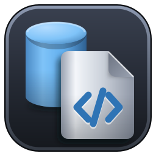 rudbgen

[](https://github.com/xcomart/rudbgen/actions/workflows/ci.yml)
[](LICENSE)


A multi-platform source-code generator written in Rust, built on
[gpui](https://gpui.rs) — the GPU-accelerated UI framework behind the Zed editor
— that reads the metadata of any database with a JDBC driver through an embedded
JVM bridge and renders it through templates. Tick tables, tick templates, get one
file per pair.

> **Status: pre-release.** rudbgen is a rewrite of
> [jdbgen](https://github.com/xcomart/jdbgen), and its template language is
> jdbgen's, engine and all — the same placeholders, conditions, loops and
> decorators, checked against jdbgen's own test suite and byte-identical output
> fixtures. Templates written for jdbgen render here unchanged, but for
> `javaType`, which now gives a `DECIMAL`, `NUMERIC` or `FLOAT` column a Java
> type that holds its values. What has changed is everything around them. See
> [docs/status.md](docs/status.md) for how far the work has come.

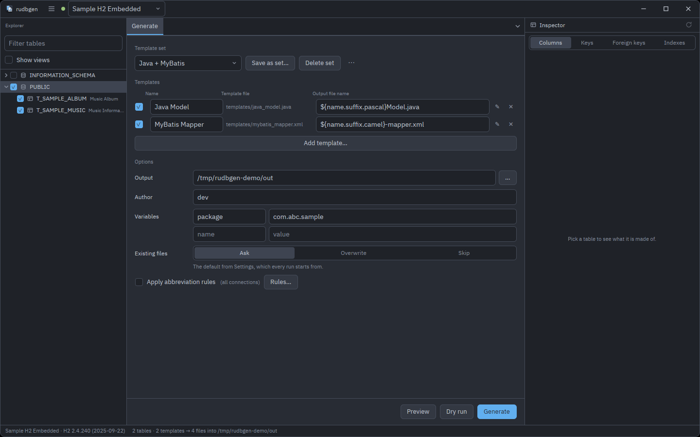

<p align="center">
  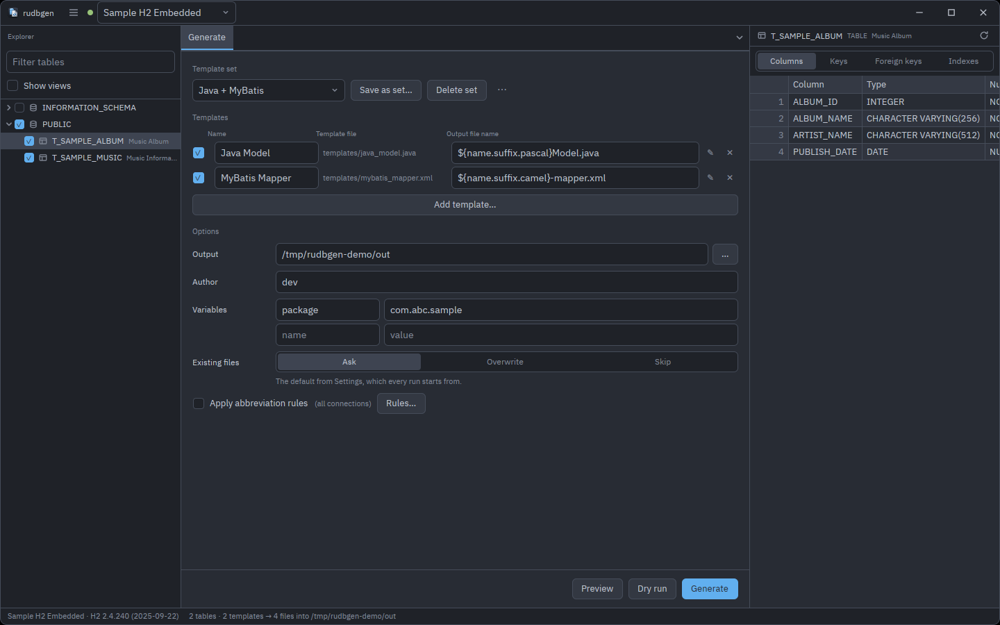
  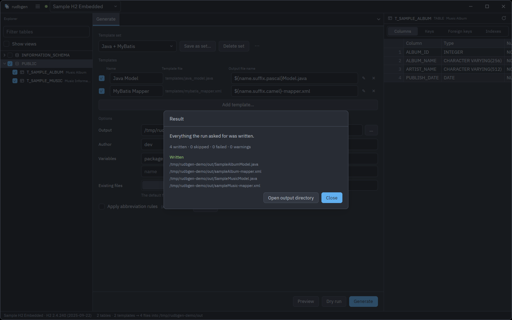
</p>

## What works today

- **One window** — a welcome screen lists saved connections; one click connects, with no stack of dialogs.
- **Connection folders** — saved connections grouped into folders that fold away.
- **No master password** — passwords and SSH passphrases live in the OS keychain, or are asked on every connect.
- **Schema explorer** — a checkbox on every table, and the ticked set remembered per connection.
- **Table inspector** — columns, primary key in key order, foreign keys both ways, and indexes.
- **Richer template model** — foreign keys, indexes, precision, scale and auto-increment available to templates.
- **Preview and dry run** — render one pair into a tab, or list every file a run would write.
- **Cancellable runs** — templates checked before writing, overwrite prompts, atomic writes and a summary.
- **Any JDBC driver** — downloaded from Maven Central or picked from disk, each in its own class loader.
- **Custom metadata queries** — jdbgen's four queries, with a Test button that names a missing label.
- **SSH tunnels** — agent, password or key auth through a bastion, `nologin` jump hosts included.
- **Template editor** — highlighting, live preview against a table, unknown-field marks and completion.
- **Portable template sets** — a set and its templates exported to one file and imported elsewhere.
- **Abbreviation rules** — table and word rules in an editor, matched whatever the case.
- **jdbgen import** — connections, drivers, template sets and rules read once from jdbgen's `config.json`.
- **Themes and languages** — UI and editor themes with live preview, and eight interface languages.

<details>
<summary>More screenshots</summary>

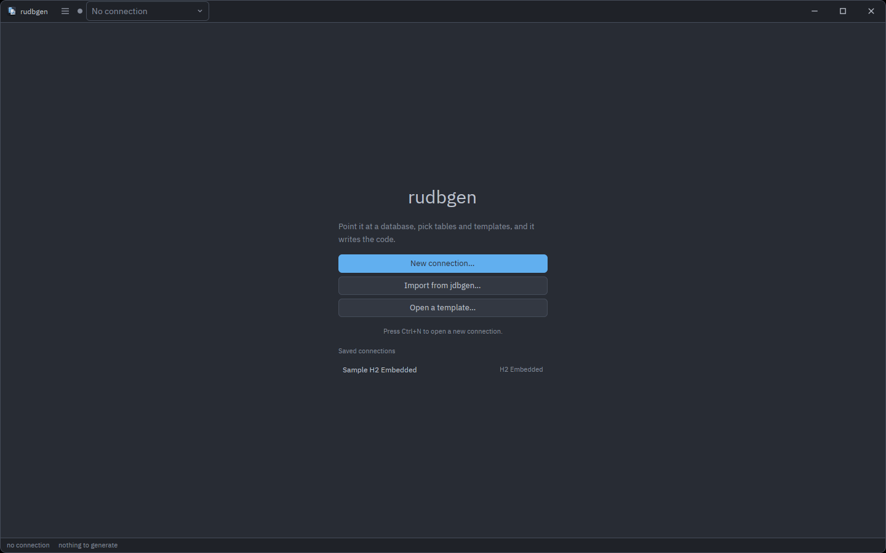
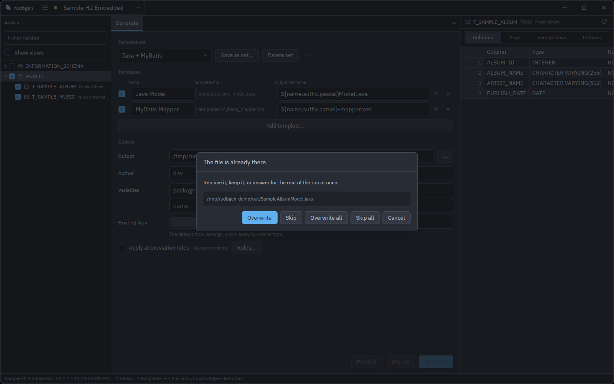
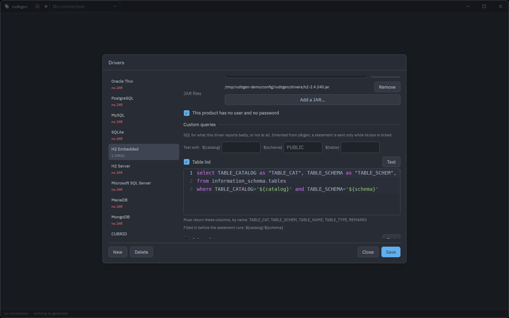
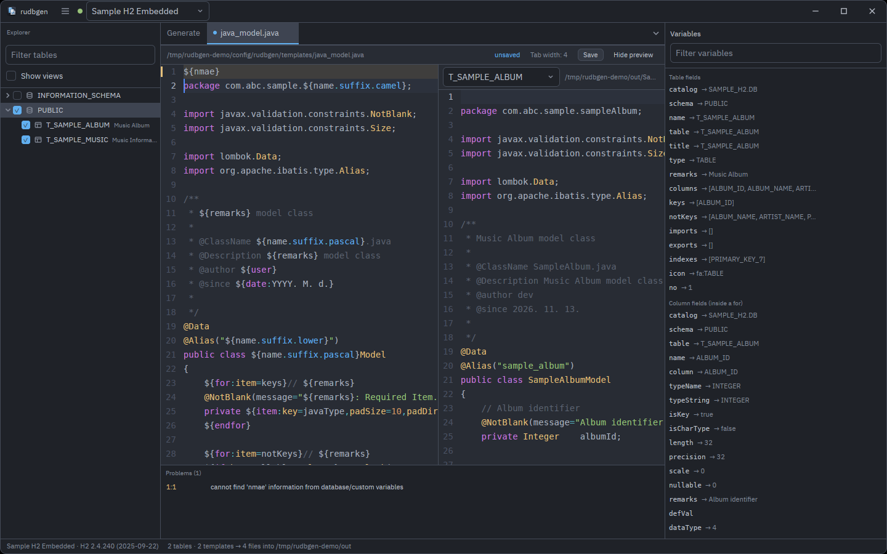
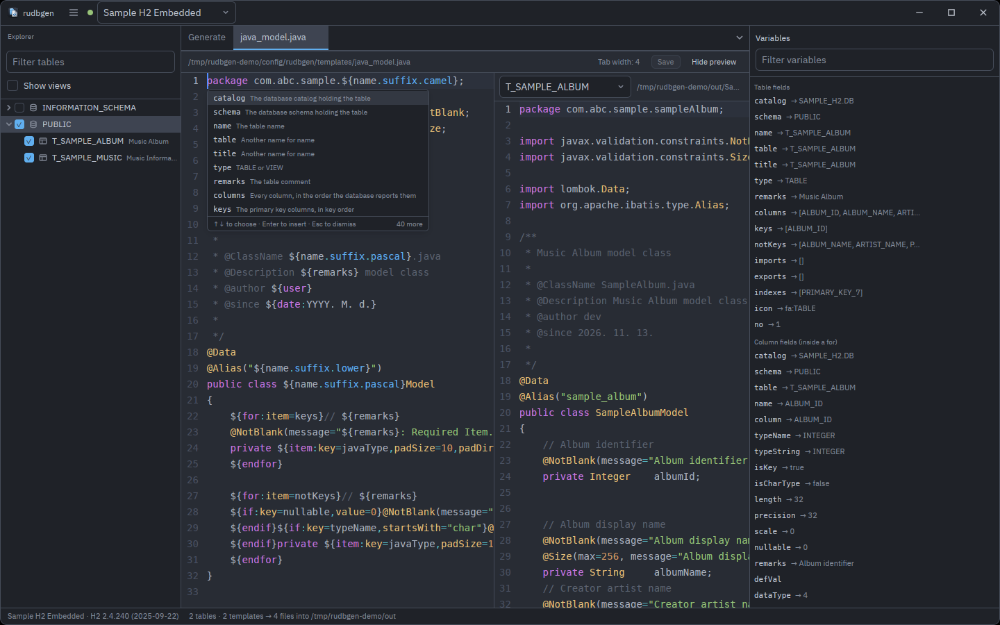
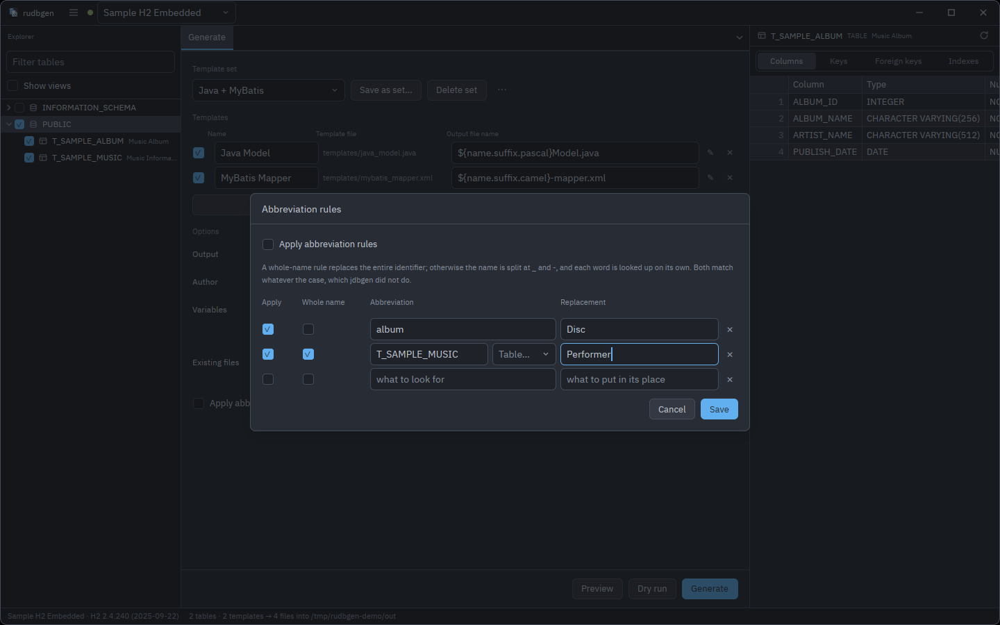
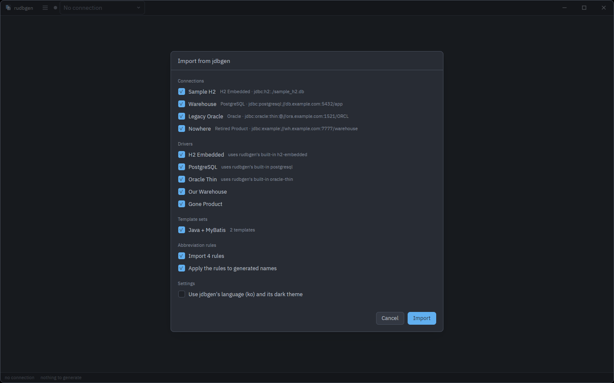

</details>

## Installing

Download the build for your platform from
[Releases](https://github.com/xcomart/rudbgen/releases). **No JDK needed** —
every download carries a Java runtime built with `jlink`, and rudbgen uses the
one next to its executable.

- **Windows** — two downloads, the same program inside.
  - `…-setup.exe` is an installer. It installs into your user profile, so it
    needs no administrator rights and raises no UAC prompt, and it adds a
    Start-menu entry plus an **Apps & features** entry you can uninstall from
    later. Uninstalling removes only the program: settings, themes and saved
    connections stay. This is also what `winget` installs.
  - `….zip` is the same tree, portable. Unzip it wherever you like and run
    `rudbgen.exe` from inside the folder — keep the folder together, because
    the executable finds its Java runtime and bridge JAR beside itself.

  Either way the executable is self-signed at best, so SmartScreen may say
  "Windows protected your PC"; choose **More info → Run anyway**.
- **macOS** — unpack the `.tar.gz` and drag `rudbgen.app` to Applications. The
  bundle is ad-hoc signed rather than notarized, so Gatekeeper quarantines
  it on arrival: the first launch needs **right-click → Open** instead of a
  double-click, and if macOS still refuses (newer versions offer no way
  through), drop the quarantine flag and launch normally:

  ```sh
  xattr -r -d com.apple.quarantine /Applications/rudbgen.app
  ```

  On macOS 15 and later there is a second hurdle. The system asks each app
  separately for permission to reach the local network, and because the
  bundle is only ad-hoc signed it usually never gets the prompt and never
  appears under **System Settings → Privacy & Security → Local Network**,
  which offers no way to add an app by hand. The permission is then denied
  silently: connections to a database on your LAN — a `192.168.x.x` or
  `10.x.x.x` address, or a `.local` name — fail with "No route to host",
  while `localhost` connections work as usual. The dependable way through is
  to launch the binary from Terminal, whose execution context is always
  allowed on the local network:

  ```sh
  /Applications/rudbgen.app/Contents/MacOS/rudbgen
  ```

  It has to be the executable itself; `open rudbgen.app` hands the launch to
  launchd and does not count. If you would rather try to get the prompt
  back, run `tccutil reset All com.aihouse.rudbgen`, delete every copy of
  `rudbgen.app` (empty the Trash too), reboot, then reinstall and launch —
  with an ad-hoc signature it may or may not ask. Updating to macOS 15.2 or
  newer, which fixed several of these cases, also helps.
- **Linux** — unpack the `.tar.gz` and run `./install.sh`. It copies the tree
  to `~/.local/share/rudbgen`, links it from `~/.local/bin/rudbgen`, and
  installs the desktop entry and icons. Needs no root, and the launcher in
  the application menu works whether or not `~/.local/bin` is on your `PATH`
  (add it to start rudbgen from a shell too). The binary needs glibc 2.35 or
  newer: Ubuntu 22.04, Debian 12 and later, or a distribution built on them,
  MX Linux 23 among them. The script checks for it and for the system
  libraries rudbgen needs — libxcb, xkbcommon with its X11 half and an EGL or
  Vulkan loader — and prints the command that installs any that are missing.

Each archive also carries a sample H2 database under `sample/`, so there is
something to connect to before there is anything to connect to.

Every platform's caveats, the data directory, the keychain and the updater are
in [docs/installation.md](docs/installation.md).

The bundled runtime always wins when it is there. `RUDBGEN_JAVA_HOME` (Java 17
or newer), then `JAVA_HOME`, are only consulted when there is no `runtime`
directory beside the executable.

## Building

Prerequisites: stable Rust, and a JDK (17+) for the bridge.

```sh
# The Java half first: the Rust build refuses to proceed without the bridge JAR.
cd bridge && ./gradlew build && cd ..

# Then the workspace.
cargo build --release
```

`cargo build` does not invoke Gradle — having a JVM start every time you fix a
line of Rust would be intolerable. `rudbgen-jdbc`'s build script only checks that
`bridge/build/libs/rudbgen-bridge.jar` exists and tells you what to run when it
does not.

A build from source has no bundled runtime, so it looks for a JVM on the system —
`RUDBGEN_JAVA_HOME`, then `JAVA_HOME`, then the usual locations. Only the release
archives ship a runtime of their own.

Running the tests mirrors CI: the bridge suite first, then the Rust workspace,
whose integration tests boot a real JVM against a real in-memory H2 (the driver
JAR comes from the Gradle cache, or from `RUDBGEN_TEST_H2_JAR`):

```sh
cd bridge && ./gradlew build && cd ..
cargo test --workspace
```

On Linux, gpui links against `libxkbcommon` (with its X11 half),
`wayland-client` and `fontconfig` development packages; see
[.github/workflows/ci.yml](.github/workflows/ci.yml) for the exact list.

Release archives are built by
[.github/workflows/release.yml](.github/workflows/release.yml) from a version
tag: Gradle, then `jlink`, then `cargo`, then packaging.

## Documentation

- [Installation](docs/installation.md) · [User interface
  guide](docs/ui-guide.md)
- [Template reference](docs/template-reference.md) — the language, its fields,
  and every place the port deliberately differs from jdbgen
- [Custom queries](docs/custom-queries.md) — for a driver whose metadata is
  wrong

## Architecture

SSH transport, tunnel ownership, connection validation and saving, and JVM
startup come from [rudbkit](https://github.com/xcomart/rudbkit), pinned to one
Git revision in the root Cargo manifest. Cargo fetches it automatically. The
application keeps its own settings, keychain, Java bridge protocol and dialog
layout; its SSH crate is a compatibility facade over the shared transport.

Everything rudbgen draws with comes from **rugpui** — the gpui widget kit, the
virtualized grid, the code editor and **rugpui-shell**, the layer above them,
extracted so that the three applications that had been carrying byte-identical
copies of them ([rulogman](https://github.com/xcomart/rulogman),
[rudbman](https://github.com/xcomart/rudbman) and this one) share one copy and
one fix. `rugpui-shell` is the application-shaped half of that: the window that
draws its own title bar, the self-updater, the about and update dialogs, the
palette catalogs and their editor, the split-pane tree and the pieces a
settings form is built out of. It knows nothing about rudbgen — the name, the
version, the release endpoints, the words and the ignored-release tag are
injected at start-up. rugpui also vendors the gpui these widgets are written
against: a pinned
revision of Zed's monorepo rather than crates.io, whose newest release (0.2.2)
predates the split of the crate into a platform-independent core, a
`gpui_platform` facade and per-OS backends, with four crates patched on top of
it for the live title-bar switch, three X11 fixes and a macOS 26 blur fix
upstream has no answer for.
The root [`Cargo.toml`](Cargo.toml) explains why the patch table here has to
point at rugpui's copies rather than carry its own.

### Third-party libraries

The heavy lifting is done by these projects:

| Library | Role |
| --- | --- |
| [gpui](https://github.com/zed-industries/zed/tree/main/crates/gpui) | GPU-accelerated UI framework, from the Zed editor (a pinned git revision, partly vendored and patched in rugpui) |
| [jni](https://github.com/jni-rs/jni-rs) | Starts the embedded JVM and calls into the JDBC bridge |
| [Gson](https://github.com/google/gson) | The bridge's one Java dependency: JSON for metadata and requests |
| [russh](https://github.com/warp-tech/russh) | Pure-Rust SSH client behind the tunnels, through rudbkit |
| [tokio](https://github.com/tokio-rs/tokio) | Async runtime for the SSH tunnel |
| [keyring](https://github.com/open-source-cooperative/keyring-rs) | OS credential store: Windows Credential Manager, macOS Keychain, Secret Service |
| [RustCrypto](https://github.com/RustCrypto) | `aes`, `aes-gcm`, `cbc`, `pbkdf2` and `sha2`: reading jdbgen's two encryption formats on import |
| [directories](https://github.com/soc/directories-rs) | Per-platform configuration paths, and where jdbgen keeps its own |
| [ureq](https://github.com/algesten/ureq) | The one HTTPS client: driver downloads from Maven Central, and the update check |

Supporting crates:
[serde](https://github.com/serde-rs/serde) /
[serde_json](https://github.com/serde-rs/json) (connections, settings, template
sets and the bridge's metadata),
[uuid](https://github.com/uuid-rs/uuid) (connection and driver identity),
[anyhow](https://github.com/dtolnay/anyhow) /
[thiserror](https://github.com/dtolnay/thiserror) (errors),
[log](https://github.com/rust-lang/log) /
[env_logger](https://github.com/rust-cli/env_logger) (logging),
[futures](https://github.com/rust-lang/futures-rs) /
[async-trait](https://github.com/dtolnay/async-trait) (async glue),
[parking_lot](https://github.com/Amanieu/parking_lot),
[chrono](https://github.com/chronotope/chrono) (`${date}` formatting),
[regex](https://github.com/rust-lang/regex) (the template language's
`matches` conditions),
[unicode-width](https://github.com/unicode-rs/unicode-width) (padding by display
width),
[base64](https://github.com/marshallpierce/rust-base64) /
[zeroize](https://github.com/RustCrypto/utils/tree/master/zeroize) (jdbgen's
encrypted values, and wiping the master password),
[rust-i18n](https://github.com/longbridge/rust-i18n) /
[sys-locale](https://github.com/1Password/sys-locale) (localization).

Linux only: [secret-service](https://github.com/hwchen/secret-service-rs)
(creating a default keyring when there is none). Windows only:
[windows-rs](https://github.com/microsoft/windows-rs) (the parent console for
`--version`), [winresource](https://github.com/BenjaminRi/winresource) (icon
embedding). Tests additionally use [tempfile](https://github.com/Stebalien/tempfile),
and [H2](https://github.com/h2database/h2database) and
[JUnit](https://github.com/junit-team/junit5) on the bridge side.

## AI-assisted development

Parts of the code in this repository were generated with AI coding agents. That
code is held to the same tests and CI checks as code written by hand, and the
maintainers are responsible for it in the same way. If you use an agent to
contribute, first read
[Using AI coding agents](CONTRIBUTING.md#using-ai-coding-agents) in the
contribution guide.

## Contributing

See the [contribution guide](CONTRIBUTING.md) for development setup, bridge and
database tests, template compatibility and the workflow for submitting changes.

## License

[MIT](LICENSE). The gpui crates rugpui vendors keep their upstream licenses.
