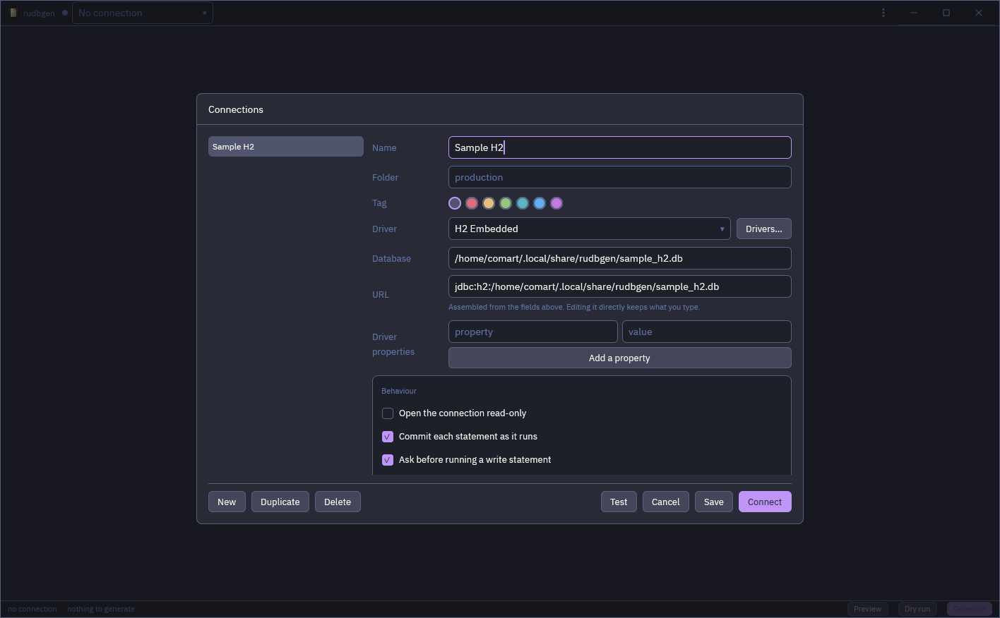
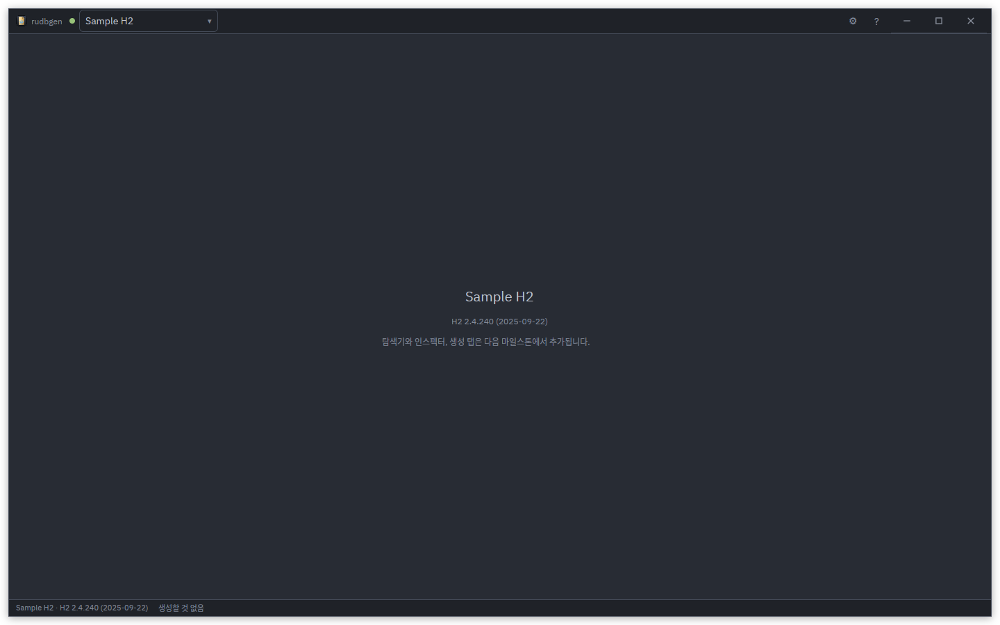

# User interface guide

rudbgen is **one window**. There is no modal gate to get through before you can
see anything, no separate generator dialog and no master password: the window
opens on a welcome screen, and everything else happens inside the same frame.

This guide describes the interface as it is in the current release, which is
every surface the [architecture document](architecture.md) §4 describes.

[← Documentation index](README.md)

- [The welcome screen](#the-welcome-screen)
- [Connecting](#connecting)
- [The driver editor](#the-driver-editor)
- [The window](#the-window)
- [The explorer](#the-explorer)
- [The inspector](#the-inspector)
- [The Generate tab](#the-generate-tab)
- [Abbreviation rules](#abbreviation-rules)
- [The template tab](#the-template-tab)
- [Preview and dry run](#preview-and-dry-run)
- [Running the generation](#running-the-generation)
- [Importing from jdbgen](#importing-from-jdbgen)
- [Settings](#settings)
- [Keyboard shortcuts](#keyboard-shortcuts)

## The welcome screen


With nothing connected, the work area is the welcome screen: your saved
connections — grouped under their folders, marked with their color tag, each
with the name of its driver — and a **New connection** button. The connection
you had open last carries a highlight. Clicking a row connects; while it opens,
the row shows a spinner and a **Cancel**, and clicking it again does not start
over. Rows are in the <kbd>Tab</kbd> order, so <kbd>Enter</kbd> on one connects
too. Right-click a row for **Connect**, **Edit…** (the connection dialog over
that profile), **Duplicate** (a copy, without the password) and **Delete…**,
which asks first. The explorer and the inspector stay out of the frame until a
connection opens, so there is nothing on screen that has nothing to say.

**Open a template…** under it opens a template file in a tab of its own, with no
database in the picture at all: editing a template needs no connection, and only
the live preview does. **Import from jdbgen…** appears above it when a jdbgen
`config.json` is where jdbgen keeps it — see [Importing from
jdbgen](#importing-from-jdbgen); the same command is in the menu whether or not
it is, so a configuration copied from another machine still has a door.

## Connecting



**New connection** (or <kbd>Ctrl</kbd>/<kbd>Cmd</kbd>+<kbd>N</kbd>) opens the
connection dialog on a new, blank profile: a name, a driver, the URL,
credentials, extra properties, a keep-alive probe and an SSH tunnel. **Manage
connections…** in the menu opens the same dialog over the saved profiles — the
open one, or the first — to edit them.

Inside the dialog <kbd>Enter</kbd> in a field connects, a double click on a
profile in the list connects to it, <kbd>Ctrl</kbd>/<kbd>Cmd</kbd>+<kbd>N</kbd>
adds a profile and <kbd>Ctrl</kbd>/<kbd>Cmd</kbd>+<kbd>S</kbd> saves.

Set **Folder** to group saved connections in the list. Click a folder heading
to collapse or expand it, or focus it with <kbd>Tab</kbd> and press <kbd>Space</kbd>
or <kbd>Enter</kbd>. Collapsed folders keep their state when you reopen the
dialog during the same app session, and folding one keeps the current form's
unsaved edits.

- **The driver** picks the URL shape. Choosing one fills the URL with its
  template — `jdbc:postgresql://{host}:{port}/{database}` — and the fields under
  it fill the holes; the URL stays editable, so an option the form has no field
  for is typed straight into it. A driver marked as needing no authentication (a
  file-backed H2 or SQLite) hides the credential fields instead of asking a
  question with no answer.
- **The password** goes to the OS keychain, never to `connections.json`. See
  [Installation](installation.md#passwords-and-the-os-keychain). Untick
  **Remember password** and nothing is written there for that profile — the
  tunnel's secret included — and the window asks for the password each time
  the connection opens. A keychain that refuses the password does not stop
  **Connect**: the profile is saved, the connection opens with what you typed,
  and the status bar says the password was not kept.
- **Test** opens the connection, reports what came back, and closes it again.
- **SSH tunnel** takes a bastion host, an SSH agent, a password or a private
  key, and binds only on loopback. It does not ask for a PTY, so a `nologin`
  jump host works.
- **Save** and **Connect** (which saves, then opens the connection) are the only
  things that write. Every field is a draft until then — cancel and nothing
  changed, including the keychain. With edits on the form, **Cancel**,
  <kbd>Esc</kbd> and a click beside the dialog ask before throwing them away.

The title bar carries the connection selector: the open connection with a status
dot (connecting, connected, failed), every saved connection under it, and a
**Disconnect** row — **Cancel connecting** while one is still opening. Picking
the connection that is already open does nothing. Switching connections swaps the explorer and the Generate
tab's options, because those belong to the connection; open template tabs stay.
**Disconnect** goes back to the welcome screen and closes the template tabs on
the way, asking about any with unsaved edits — *Cancel* keeps the connection.



A connection that fails says so on the status bar and in a banner on the welcome
screen — never in a box you have to dismiss before you can read the URL that was
wrong. The banner says what the failure suggests (the password, the driver JAR,
the address), offers **Trust this key** with the fingerprint when a bastion's
host key is new, and has **Edit connection…** and **Retry**. A database that
refuses the password asks for it again, with **Remember password** to keep it
once it works.

## The driver editor


**Drivers…** beside the driver picker replaces the connection dialog's body with
the driver editor — one tab ring, never a dialog inside a dialog. It holds the
driver's class, its JARs, its URL template, its default port and the properties
handed to every connection that uses it.

- **JARs** come from Maven Central by coordinate (`group:artifact:version`, with
  a progress bar and a Cancel) or from disk.
- **The driver class is detected** from the JARs with **Detect** rather than
  typed: rudbgen asks the bridge which `java.sql.Driver` implementations they
  hold, without running a single static initializer. Picking a sources or
  javadoc JAR by mistake says so in those words.
- **Custom queries** is the section at the bottom: four rows — table list,
  column list, table comments, column comments — each a tick, a SQL field, the
  contract it has to satisfy, and a **Test** button. One shared row of test
  values above them supplies `${catalog}`, `${schema}` and `${table}`.

  This is jdbgen's four SQL overrides, for products whose driver reports its
  metadata badly or not at all. [Custom queries](custom-queries.md) is the
  reference; the short version is that Test runs the statement on a session
  using this driver and tells you which required label is missing, rather than
  letting you find out in the middle of a generation run.

## The window

Once connected the window is three columns over a status bar:

```
┌ [⌂ rudbgen] [☰] [● Sample H2 ▾]                              ─ □ ✕ ┐
├──────────────┬─────────────────────────────────┬─────────────────┤
│ EXPLORER     │ WORK AREA (tabs)                │ INSPECTOR       │
│ 🔍 filter    │ ┌ Generate ┐┌ Preview ┐         │ T_SAMPLE_ALBUM  │
│ ☐ views      │ │                                │ Columns│Keys│FK│
│ ▾ PUBLIC     │ │  Template set  [Java + MyBatis▾]│ # name  type  K │
│   ☑ T_ALBUM  │ │  ☑ Java Model  ${…}Model.java  │ 1 ALBUM_ID INT ● │
│   ☑ T_ARTIST │ │  ☑ Mapper XML  ${…}-mapper.xml │ 2 NAME  VARCHAR  │
│   ☐ T_TRACK  │ │  ☐ PHP CI      …               │ …               │
│ ▸ INFO_SCHEMA│ │  Output   ~/out/src      [...]  │                 │
│              │ │  Author   comart                │                 │
│              │ │  Variables  package=com.abc.x   │                 │
│              │ │ [Preview] [Dry run] [Generate] │                 │
├──────────────┴─────────────────────────────────┴─────────────────┤
│ 2 tables · 2 templates → 4 files into ~/out/src                    │
└──────────────────────────────────────────────────────────────────┘
```

Both side panels are resized by dragging their own inner edge — a six-pixel
grab band that lights an accent bar while the pointer is on it, the same one a
splitter's seam shows — and both remember their width; both toggle
with a shortcut (<kbd>Ctrl</kbd>+<kbd>B</kbd>, <kbd>Ctrl</kbd>+<kbd>I</kbd>) and
both disappear when nothing is connected.

The rule the layout follows: **selection lives in the explorer, options live in
the work area, the verdict lives in the status bar.** The three never overlap.

## The explorer


Catalog → schema → table, fetched lazily: a schema's tables are read the first
time you expand it and cached after that.

- **The filter box** is a contains match, case-insensitive — jdbgen's rule.
- **The views toggle** shows or hides views. Both forms are fetched either way,
  so flipping it costs no round trip.
- **A checkbox on every row.** The ticked set is what will be generated. It
  survives filtering, the views toggle, collapsing a node and a refresh, and it
  is kept with the connection: the next time the connection opens, the same
  tables are ticked again. A ticked table the database no longer has is
  unticked, and a line under the filter names it. A schema's own box is three-state and acts on the
  rows **currently on screen**, so it composes with the filter instead of
  fighting it.
- **Right-click** offers *select all shown*, *clear*, *invert*, *open in
  inspector* and *refresh*.
- **A long name keeps its room.** The table's comment beside it gives way
  first, and hovering the row shows `SCHEMA.TABLE — comment` in full.

Ticking a row is never the same gesture as selecting it: the checkbox swallows
its own press.

## The inspector

The panel on the right shows the table under the cursor — fetched in the
background, cached per table, so walking the tree costs one round trip each.
Runs, previews and the variable palette read their tables from the same cache.
The panel's own refresh button reads the table on screen again; the explorer's
*refresh* drops every cached table, so after changing the schema it is what
makes the next run see the new columns.
Four tabs:

| Tab | What it shows |
|:---|:---|
| Columns | Ordinal, name, type, nullability, default, `PK`*n* and comment |
| Keys | The primary key, **in key order** rather than column order |
| Foreign keys | Both directions — what this table points at, and what points at it |
| Indexes | Name, uniqueness, columns in index order |

This is the same model the templates see, so it doubles as a way to check what a
template will get. Foreign keys and indexes are new in rudbgen; jdbgen showed
neither.

With a template tab active the inspector becomes the **variable palette**
instead: every field the current model offers — table fields, column fields,
foreign keys, indexes, the statements, the decorators, the conditions and your
own custom variables — each with a one-line description, filterable, and
clickable to insert `${…}` at the caret. See [The template
tab](#the-template-tab).

## The Generate tab


The Generate tab is permanent and is the **only** place a connection's
generation profile is edited. Everything on it is saved to that connection as
you change it — debounced, and only when it actually differs from what was last
written.

- **Template set** — the saved sets, plus `Custom` as soon as the list matches
  none of them (and *Choose a set…* while the list is empty). Two sets ship:
  *Java + MyBatis* and *PHP CodeIgniter*; the sample connection comes with the
  first already in its list, and an output folder of its own. Picking a set
  over a list you edited replaces it — with an **Undo** above the list.
  **Save as set…** stores the current list under a name. It opens on the name
  of the set the list came from: keep that name and the button reads
  **Overwrite**, which replaces that set with the list as it now stands — same
  place in the selector — while any other name is saved as a new set.
- **The template list** — one row per template under the column headings: a
  tick, its name, its file, the **output name template** that names the file it
  writes, and buttons to edit or remove it. Removing a row can be undone the
  same way. An empty list offers each set as a button, beside *Add template…*,
  which opens a file picker.

  The output name is itself a template: `${name.suffix.pascal}Model.java`, or
  `${package.replace('.','/')}/${name.suffix.pascal}.java` to write into a
  package tree — the directories are created for you. An absolute path, or one
  that climbs out of the output directory with `..`, is refused, and so — on
  every platform — is a name Windows cannot hold: a reserved device name such as
  `CON` or `com1.java`, one of `<>:"|?*` or a control character, or a component
  ending in a dot or a space.
- **Output** — the output directory, with a chooser.
- **Author** — what `${author}` renders as.
- **Variables** — your custom variables, a key/value table with a trailing
  empty row that becomes a real row as soon as you type in it.
- **Existing files** — what the next **Generate** does with a file that is
  already there: *Ask*, *Overwrite* or *Skip*. It starts at the default from
  Settings, and a different pick lasts for one run.
- **Apply abbreviation rules** — the switch that inserts `.abbr` into every
  `${name}` reference automatically. It is marked *(all connections)*: unlike
  everything else on the tab it is not the connection's, but lives with the
  rules in `abbreviations.json`. **Rules…** beside it opens the [rules
  editor](#abbreviation-rules); the switch there and the switch here are the
  same value.

The **Edit** glyph on a template row — or a double click on its file — opens
that template in [a tab of its own](#the-template-tab).

## Abbreviation rules


An abbreviation rule rewrites a piece of an identifier on its way into a
generated name: `EMP` → `Employee`, `NO` → `Number`. The list is **global**, not
per connection — a shop's vocabulary is a fact about the shop — and lives in
`abbreviations.json`. Open the editor with **Rules…** on the Generate tab, or
from the menu.

Each row is a rule:

| Column | What it means |
|:---|:---|
| **Apply** | Whether the rule takes part in a run. A tick, not a deletion: switching a rule off for one project does not cost you the rule |
| **Whole name** | Whether it replaces the entire identifier rather than one word inside it |
| **Abbreviation** | What to look for |
| **Replacement** | What to put in its place. May be empty, which is how a `TB_` prefix is stripped |

**How a name is rewritten.** A whole-name rule replaces the entire identifier
and ends there. Otherwise the name is split at `_` and `-`, and each word is
looked up on its own, separators kept where they were. Both kinds match
**whatever the case** — a deliberate behavioral difference from jdbgen, whose
word rules only ever matched lower-case segments and therefore never fired on
`TB_USR`. So `album` → `Disc` turns `T_SAMPLE_ALBUM` into
`T_SAMPLE_Disc`.

The last row is always empty and becomes a real one the moment you type in it;
an emptied row is dropped when you save. Beside the **Abbreviation** field of a
whole-name row is a picker offering the tables the explorer has loaded, so a
rule about a table is written against a name that exists rather than one typed
from memory. It appears only while something is connected.

Two rules that are on, are of the same kind, and look for the same thing (case
ignored) would end as one entry in the dictionary, and which of the two survived
would be invisible. **Save** (or <kbd>Ctrl</kbd>+<kbd>S</kbd>) is disabled while
that stands, and the offending rows are outlined. Nothing is written until
**Save**; **Cancel**, <kbd>Esc</kbd> or a click beside the dialog asks before a
changed draft is thrown away.

## The template tab


A template opens in a tab of its own from the **Edit** glyph on the Generate
tab, from *Open a template…* on the welcome screen, or from the menu. It is the
editor with template-language highlighting on the left, a **live preview** on
the right, and the [variable palette](#the-inspector) in place of the inspector.

- **The preview follows the buffer, not the file.** It renders the text as it
  now stands against the table named in its header — pick another from the
  dropdown — so a change shows before it is saved.
- **Right-click the editor** for Cut, Copy, Paste, Select all, Undo, Redo,
  Find, Replace, and Save. The menu keeps the current text selection.
- **Scroll either side** with the mouse wheel or scrollbar to move both views
  to the same relative position, even when the generated output is longer.
- **Diagnostics** are gutter marks with a message: a parse error stops the
  render and names the line; an **unknown field** — `${nmae}` — is a warning,
  because the engine renders it to nothing and jdbgen's way of finding it was to
  read the generated file. Clicking a diagnostic jumps the caret to it, and so
  do <kbd>F8</kbd> (the next one) and <kbd>Shift</kbd>+<kbd>F8</kbd> (the
  previous one); the list's rows are in the <kbd>Tab</kbd> order as well.
- <kbd>Ctrl</kbd>+<kbd>S</kbd> writes the file; the tab carries a dirty marker
  until it does, and closing a dirty tab asks first.
- <kbd>Ctrl</kbd>+<kbd>Shift</kbd>+<kbd>P</kbd> shows and hides the preview
  half.


<kbd>Ctrl</kbd>+<kbd>Space</kbd> — and typing `${` — offers what may be written
where the caret is: the statement names at the start of one, the option names
inside it, and the fields of the current model. Each entry carries the same
one-line description the palette shows. Where an input method takes
<kbd>Ctrl</kbd>+<kbd>Space</kbd> for itself — most Korean, Japanese and Chinese
desktops, and macOS's input source switch — <kbd>Alt</kbd>+<kbd>/</kbd> does the
same, and so does **Suggest** in the menu.

**New template…** in the menu starts one from nothing: the save dialog opens in
the `templates/` folder of the [configuration
directory](installation.md#where-rudbgen-keeps-your-data), and the file you name
there is created empty and opened. Give it the extension of what it will
write — `dto.java`, or `dto.java.tpl` — since that picks the highlighting. A
file that is already there is opened as it is, never emptied. While a
connection is open, a template tab whose file is not in the connection's list
shows **Add to generation list** in its header — also in the menu and the tab's
right-click menu — which adds it, ticked.

A run reads its templates from their files. Starting one while a ticked
template's tab has unsaved edits asks first: **Save and run**, **Run without
saving** (the files as they are) or **Cancel**.

The tab strip works from the keyboard: <kbd>Ctrl</kbd>+<kbd>PageDown</kbd> /
<kbd>Ctrl</kbd>+<kbd>PageUp</kbd> (or <kbd>Ctrl</kbd>+<kbd>Tab</kbd> /
<kbd>Ctrl</kbd>+<kbd>Shift</kbd>+<kbd>Tab</kbd>) move to the next and previous
tab, <kbd>Ctrl</kbd>+<kbd>1</kbd>–<kbd>9</kbd> go to a tab by number,
<kbd>Ctrl</kbd>+<kbd>W</kbd> closes the tab on top as its close button would,
and <kbd>F6</kbd> puts the keyboard on the strip itself, where the arrows walk
it and <kbd>Delete</kbd> closes. Right-click a tab for *Close tab*, *Close other
tabs*, *Close tabs to the right* and, on a template, *Copy path*. The Generate
tab is never closed.

## Preview and dry run

Both sit beside **Generate** at the bottom of the connected **Generate** tab,
in a fixed row of standard-sized buttons below the scrolling options. The
status bar shows the arithmetic of the run: *n* tables · *m* templates → *n*×*m*
files into the output directory. The Generate tab is permanent and has no
close button.

- **Preview** opens a Preview tab and renders **one** pair — pick the table and
  the template from the two dropdowns in its header.
- **Dry run** renders **all** of them without writing anything — saying
  *Rendering…*, with a **Cancel**, while it does — and lists what would happen:
  every path under the output directory (the full one on hover), whether it
  replaces an existing file, and how big it would be. Selecting a row shows the
  text underneath, and **Generate** above the list writes what it shows. With
  no output directory chosen yet the paths are shown under a temporary one, so
  every file reads *new*; the line above the list says so.

A dry run is the cheap way to find out that an output name template collides, or
that a template fails on one particular table.

## Running the generation

**Generate ▶** (<kbd>F5</kbd>, or <kbd>Ctrl</kbd>+<kbd>Shift</kbd>+<kbd>G</kbd>
off macOS) is disabled with a reason in its
tooltip — *no connection*, *no tables ticked*, *no templates ticked*, *no output
directory* — rather than an error box after the click. The first missing thing is
the one it names.

Every template is parsed **before** any file is written, so a template with a
syntax error costs you nothing: the run stops, names the template, which half of
it (body or output name) and the line. The same holds for two tables or
templates whose output names land on the same file (ignoring case on Windows and
macOS): every name is worked out first, and the run stops with each colliding
pair listed beside the pairs it collides with.


While it runs, a progress dialog shows a bar, a log that follows the newest line
unless you scroll it up, and **Cancel** — cancellation
takes effect at the next file boundary, so a half-written file is never left
behind. Ticked tables the inspector has not described yet are read first, in the
same dialog; **Cancel** during that phase closes it, and nothing is written or
previewed. When a file already exists, the *ask* policy asks, with **Overwrite**,
**Skip**, **Overwrite all**, **Skip all** and **Cancel**; the question has the
keyboard, so <kbd>Enter</kbd> is **Overwrite** and <kbd>Esc</kbd> is **Cancel**.
The policy starts at a setting (`ask`, `overwrite` or `skip`) and the Generate
tab's **Existing files** can pick another for one run.


At the end comes the result summary: every file written, skipped and failed —
with the failing template's line for each failure — every unknown-field warning
with the table and template it came from, and **Open output directory**.

Files are written atomically, so a crash cannot leave a truncated source file in
your tree.

## Importing from jdbgen


**Import from jdbgen…** on the welcome screen — also in the menu — moves a
[jdbgen](https://github.com/xcomart/jdbgen) configuration across in one pass. It
is offered whenever rudbgen can find `config.json` in jdbgen's own configuration
directory, and **Other file…** points it at a copy from another machine.

jdbgen keeps the connection URL, the user name and the password encrypted behind
a master password. rudbgen has none: it asks for jdbgen's **once**, here
(<kbd>Enter</kbd> is *Next*), reads both of jdbgen's encryption formats, and then
puts the passwords where they belong — the OS keychain. The password is not kept
a moment longer than the step it is typed in, and **your jdbgen configuration is
never touched**: the file is opened read-only, so changing your mind leaves you
with a working jdbgen.

The second step is a checklist. Connections, drivers, template sets and
abbreviation rules each have a tick, and under them:

- **Settings** — jdbgen's language and its light/dark choice, off by default.
- **Names that are already taken** — keep both, and what comes from jdbgen is
  added with `(imported)` after its name; or leave the jdbgen entry behind. A
  driver rudbgen already ships a definition for is the common case, and *keep
  both* repoints the imported connections at the imported definition so nothing
  ends up naming a driver that is not there.
- **Worth knowing** — everything the mapping decided that you would otherwise
  have to discover: a stock driver matched onto a built-in, a connection naming
  a driver the file does not define, a keep-alive interval that is not a number,
  a template file found in neither of jdbgen's directories. The note about
  abbreviation rules matching whatever the case is always among them, because it
  changes what a rule you already have does. (A template's `javaType` for a
  `DECIMAL`, `NUMERIC` or `FLOAT` column changes as well — see the template
  reference.)

The last step reports what was written. A machine with no usable keychain is not
a failed import: those connections are saved without their password and named
here, and when you open one and the database refuses it without a password,
rudbgen asks for it.

## Settings

<kbd>Ctrl</kbd>+<kbd>,</kbd> opens Settings: the UI theme and the editor theme
(both with live preview, both importable from a file and extensible from a user
theme directory), the interface language, the fonts, the Java heap the embedded
JVM starts with and its extra arguments, the window chrome, and the default
overwrite policy. The language changes live — there is nothing to restart.
<kbd>Ctrl</kbd>+<kbd>S</kbd> saves; closing with changes on the form asks first.

While any dialog is up, the window's own shortcuts stand down: a chord pressed
in a dialog's field does nothing to the window behind it.

Eight languages ship: English, Korean, Japanese, Simplified Chinese, German,
Spanish, French and Russian.

## Keyboard shortcuts

On macOS, read <kbd>Cmd</kbd> for <kbd>Ctrl</kbd> — except in
<kbd>Ctrl</kbd>+<kbd>Space</kbd>, <kbd>Ctrl</kbd>+<kbd>PageDown</kbd>/<kbd>PageUp</kbd>
and <kbd>Ctrl</kbd>+<kbd>Tab</kbd>, which are <kbd>Ctrl</kbd> on every platform.

| Shortcut | Action |
|:---|:---|
| <kbd>Ctrl</kbd>+<kbd>N</kbd> | New connection (inside the connection dialog: a new profile) |
| <kbd>F5</kbd> | Generate (also <kbd>Ctrl</kbd>+<kbd>Shift</kbd>+<kbd>G</kbd> on Linux and Windows) |
| <kbd>Ctrl</kbd>+<kbd>B</kbd> | Show/hide the explorer |
| <kbd>Ctrl</kbd>+<kbd>I</kbd> | Show/hide the inspector |
| <kbd>Ctrl</kbd>+<kbd>,</kbd> | Settings |
| <kbd>Ctrl</kbd>+<kbd>S</kbd> | Save the template tab on top (inside a dialog: save the dialog) |
| <kbd>Ctrl</kbd>+<kbd>Shift</kbd>+<kbd>P</kbd> | Show/hide the live preview |
| <kbd>Ctrl</kbd>+<kbd>Space</kbd>, <kbd>Alt</kbd>+<kbd>/</kbd> | Suggest what may be written here |
| <kbd>F8</kbd> / <kbd>Shift</kbd>+<kbd>F8</kbd> | Next / previous problem in the template |
| <kbd>Ctrl</kbd>+<kbd>PageDown</kbd> / <kbd>Ctrl</kbd>+<kbd>PageUp</kbd> | Next / previous tab (also <kbd>Ctrl</kbd>+<kbd>Tab</kbd> / <kbd>Ctrl</kbd>+<kbd>Shift</kbd>+<kbd>Tab</kbd>) |
| <kbd>Ctrl</kbd>+<kbd>1</kbd>–<kbd>9</kbd> | Go to tab 1–9 |
| <kbd>Ctrl</kbd>+<kbd>W</kbd> | Close the tab on top |
| <kbd>F6</kbd> | Put the keyboard on the tab strip |
| <kbd>Enter</kbd> | In a question: its default answer |
| <kbd>Esc</kbd> | Close the open menu, or dismiss the dialog on top (on the overwrite question: Cancel) |
| <kbd>Ctrl</kbd>+<kbd>Q</kbd> | Quit |

Preview and Dry run are deliberately unbound: they are one button press away,
and the chords are better spent on the template editor.

---

## Related documentation

- [Template reference](template-reference.md) — the language of the files the
  template list points at.
- [Custom queries](custom-queries.md) — the driver editor's four SQL overrides.
- [Installation](installation.md) — where the settings and templates are kept.
